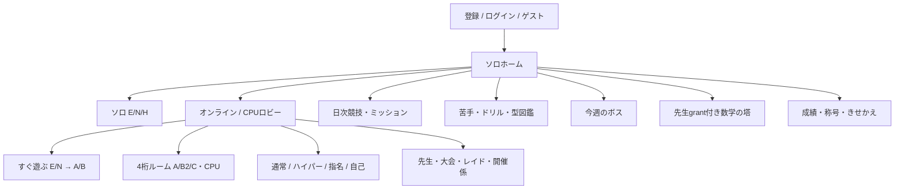

# ゲーム全体像・機能台帳

FACTOR×FACTORは高校数学の因数分解を、個人学習・競技・協力・物語へ結びつけるブラウザゲーム。数学は同じ係数エンジンを多くのモードが共有する一方、ゲーム状態・報酬・保存は複数世代ある。

## 主導線

## 台帳の読み方

以下の各記録は「目的、対象、開始、操作、ルール、終了、得点/報酬、保存、遷移、例外、実装、主要関数、テスト、状態、制約」をまとめる。数学・係数は02、保存権限は04、オンライン数値は05、全報酬は06、画面IDは15が詳細の正本。該当しないゲーム勝敗は「対象外」とし、機能の存在だけで現在の全利用者へ解放済みとはしない。

### F01 アカウント・匿名Auth

- **状態・目的**：現行・公開中。本人の記録へ接続。
- **対象・開始条件**：全員、名前1〜10文字/4桁合言葉。ゲスト可。
- **操作・ルール**：登録/ログイン/ログアウト。既存名を上書きしない。詳細は[全モード規則](02_GAME_RULES.md)。
- **終了/勝敗・得点/報酬**：対戦勝敗は対象外、成功でホーム。独立の競技でない機能は報酬・勝敗なし、連動値は06を参照。
- **保存・画面遷移**：accounts/name・pins・logins、選択はlocalStorage。起動→AccountGate→ホーム。
- **例外・制約**：UIDとaccountは別。保存不能Auth/認証失敗は案内。本番の個別ユーザー値は未読取。
- **実装・主要関数**：[index.html:3385・`function AccountGate`](https://github.com/asumax1128/factorfactor/blob/558488543e104460a35a8902c22e682c5c46f766/index.html#L3385)。**対応テスト**：[tests/account-ranking-regression.cjs](../../tests/account-ranking-regression.cjs)（今回未実行。詳細は09）。

### F02 通常ソロ・逆引き展開

- **状態・目的**：現行・公開中。速く正確な因数分解。
- **対象・開始条件**：全員、ホームでE/N/H。
- **操作・ルール**：ドラッグ2枚。後半の展開問は4択。詳細は[全モード規則](02_GAME_RULES.md)。
- **終了/勝敗・得点/報酬**：15/30/50正解・HP0、P/HP/コンボは02。独立の競技でない機能は報酬・勝敗なし、連動値は06を参照。
- **保存・画面遷移**：stats.exp/prof/mis、localTOP3、GAS、solo ghost split。ホーム→countdown→playing→gameover。
- **例外・制約**：ゲスト記録は端末。GAS送信失敗は再試行。本番の個別ユーザー値は未読取。
- **実装・主要関数**：[index.html:1457・`function FactorHunt`](https://github.com/asumax1128/factorfactor/blob/558488543e104460a35a8902c22e682c5c46f766/index.html#L1457)。**対応テスト**：[tests/legacy-regression.cjs](../../tests/legacy-regression.cjs)（今回未実行。詳細は09）。

### F03 CPU練習

- **状態・目的**：現行・公開中。対戦操作の練習。
- **対象・開始条件**：全員、オンラインロビーからA/B/C・E/N・強さ。
- **操作・ルール**：共有BattleBoard、DBXのCPUが応答。詳細は[全モード規則](02_GAME_RULES.md)。
- **終了/勝敗・得点/報酬**：方式別勝敗、勝8/他5EXP、公式戦績なし。独立の競技でない機能は報酬・勝敗なし、連動値は06を参照。
- **保存・画面遷移**：CPU設定local、登録EXP/profはRTDB。ロビー→CPU戦→BattleResult。
- **例外・制約**：CPUの旧B/Cを新B仕様に変更しない。本番の個別ユーザー値は未読取。
- **実装・主要関数**：[index.html:8391・`function CpuBots`](https://github.com/asumax1128/factorfactor/blob/558488543e104460a35a8902c22e682c5c46f766/index.html#L8391)。**対応テスト**：[tests/online-playability-browser.cjs](../../tests/online-playability-browser.cjs)（今回未実行。詳細は09）。

### F04 通常ルームの作成・参加

- **状態・目的**：現行・公開中。授業/友人の指定対戦。
- **対象・開始条件**：認証済み、4桁code、最大4、期限6時間。
- **操作・ルール**：host設定/開始、参加、CPU補充、観戦。詳細は[全モード規則](02_GAME_RULES.md)。
- **終了/勝敗・得点/報酬**：方式別。開始前退出無敗北。独立の競技でない機能は報酬・勝敗なし、連動値は06を参照。
- **保存・画面遷移**：rooms/meta/players/state等、旧stats/新B receipt。ロビー→部屋ロビー→ゲーム→結果。
- **例外・制約**：満員/無部屋/古いmeta/host閉鎖を検査。本番の個別ユーザー値は未読取。
- **実装・主要関数**：[index.html:8469・`function BattleApp`](https://github.com/asumax1128/factorfactor/blob/558488543e104460a35a8902c22e682c5c46f766/index.html#L8469)。**対応テスト**：[tests/online-regression.cjs](../../tests/online-regression.cjs)（今回未実行。詳細は09）。

### F05 オンラインA

- **状態・目的**：現行・公開中。同じ問の先着得点競争。
- **対象・開始条件**：ルーム/新レート/CPU、E/N。
- **操作・ルール**：同seedの2枚drag、誤答ロック2秒。詳細は[全モード規則](02_GAME_RULES.md)。
- **終了/勝敗・得点/報酬**：15/30枠後の得点比較・最後3問2倍。独立の競技でない機能は報酬・勝敗なし、連動値は06を参照。
- **保存・画面遷移**：claims/pts/aResult、入口別の戦績。投票/部屋→GO→GameA/BattleView→結果。
- **例外・制約**：同時入力は確定claimが根拠。詳細は02/05。本番の個別ユーザー値は未読取。
- **実装・主要関数**：[index.html:10214・`function GameA`](https://github.com/asumax1128/factorfactor/blob/558488543e104460a35a8902c22e682c5c46f766/index.html#L10214)。**対応テスト**：[tests/online-improvements.test.cjs](../../tests/online-improvements.test.cjs)（今回未実行。詳細は09）。

### F06 新時間制B2

- **状態・目的**：現行・公開中。得点と妨害の時間制競争。
- **対象・開始条件**：新規通常ルーム・レート・ゴースト、E/N。
- **操作・ルール**：drag、偽カード、counter、FREEZE自動。詳細は[全モード規則](02_GAME_RULES.md)。
- **終了/勝敗・得点/報酬**：60/90/120/180秒、HP0 KO、得点勝負。独立の競技でない機能は報酬・勝敗なし、連動値は06を参照。
- **保存・画面遷移**：game/inputs/seq/receipt、入口別stats。GO→BattleView→Result/BattleResult。
- **例外・制約**：旧B/C/先生大会は別。細則02。本番の個別ユーザー値は未読取。
- **実装・主要関数**：[server/online-rated/b2.cjs:72・`function step`](https://github.com/asumax1128/factorfactor/blob/558488543e104460a35a8902c22e682c5c46f766/server/online-rated/b2.cjs#L72)。**対応テスト**：[tests/b2.test.cjs](../../tests/b2.test.cjs)（今回未実行。詳細は09）。

### F07 旧B

- **状態・目的**：互換性維持。解き切りレース＋HP攻撃。
- **対象・開始条件**：開始済み旧戦・CPU・クラス大会。
- **操作・ルール**：drag、big/heal/shield、旧応援。詳細は[全モード規則](02_GAME_RULES.md)。
- **終了/勝敗・得点/報酬**：規定数先着/最後の生存、旧6ゲージ。独立の競技でない機能は報酬・勝敗なし、連動値は06を参照。
- **保存・画面遷移**：旧live/ev/ko/result、hist。BattleGame→GameB→BattleResult。
- **例外・制約**：新Bの時間制/FREEZEへ置換しない。本番の個別ユーザー値は未読取。
- **実装・主要関数**：[index.html:8108・`function createBEngine`](https://github.com/asumax1128/factorfactor/blob/558488543e104460a35a8902c22e682c5c46f766/index.html#L8108)。**対応テスト**：[tests/online-rated.test.cjs](../../tests/online-rated.test.cjs)（今回未実行。詳細は09）。

### F08 C・2対2

- **状態・目的**：現行・公開中。協力対人チーム戦。
- **対象・開始条件**：ルーム/CPU、4人、E/N。
- **操作・ルール**：drag、sharedHP、cover/unite/follow。詳細は[全モード規則](02_GAME_RULES.md)。
- **終了/勝敗・得点/報酬**：N×2正解か相手チームHP0。独立の競技でない機能は報酬・勝敗なし、連動値は06を参照。
- **保存・画面遷移**：rooms/thp/live/ev等、旧stats。ルーム→GameB(C)→BattleResult。
- **例外・制約**：独立レートCなし。HP差分集約あり。本番の個別ユーザー値は未読取。
- **実装・主要関数**：[index.html:7378・`const C_UNITE`](https://github.com/asumax1128/factorfactor/blob/558488543e104460a35a8902c22e682c5c46f766/index.html#L7378)。**対応テスト**：[tests/online-regression.cjs](../../tests/online-regression.cjs)（今回未実行。詳細は09）。

### F09 新レート戦・検索/投票/復帰

- **状態・目的**：現行・公開中（config依存）。同難易度で競技。
- **対象・開始条件**：登録者、enabled/protocol設定。
- **操作・ルール**：E/N検索、5秒補完、A/B投票、cancel/ACK。詳細は[全モード規則](02_GAME_RULES.md)。
- **終了/勝敗・得点/報酬**：開始前cancel無敗北、開始後leave敗北。独立の競技でない機能は報酬・勝敗なし、連動値は06を参照。
- **保存・画面遷移**：onlineSparkV1 slots/matches/profiles。ロビー→選択→wait→vote→play→result→ロビー。
- **例外・制約**：古いrevision拒否/初期化中断/切断再同期。本番の個別ユーザー値は未読取。
- **実装・主要関数**：[src/online-spark-client.cjs:465・`async function enqueue`](https://github.com/asumax1128/factorfactor/blob/558488543e104460a35a8902c22e682c5c46f766/src/online-spark-client.cjs#L465)。**対応テスト**：[tests/online-spark-emulator.cjs](../../tests/online-spark-emulator.cjs)（今回未実行。詳細は09）。

### F10 通常ゴースト・BOT補完

- **状態・目的**：現行・公開中（rules依存）。待機を避けて対戦。
- **対象・開始条件**：quick5秒、学習n≥20またはBOT。
- **操作・ルール**：A/Bを同じ入力でプレイ。詳細は[全モード規則](02_GAME_RULES.md)。
- **終了/勝敗・得点/報酬**：quickレート1/3、勝EXP8、非BOT称号。独立の競技でない機能は報酬・勝敗なし、連動値は06を参照。
- **保存・画面遷移**：ghostV1・profile.ghost・本人stats。検索→乱入→投票→戦闘→結果。
- **例外・制約**：学習統計の近似相手。完全録画再生ではない。本番の個別ユーザー値は未読取。
- **実装・主要関数**：[src/ghost-model.cjs:65・`function select`](https://github.com/asumax1128/factorfactor/blob/558488543e104460a35a8902c22e682c5c46f766/src/ghost-model.cjs#L65)。**対応テスト**：[tests/ghost-emulator.cjs](../../tests/ghost-emulator.cjs)（今回未実行。詳細は09）。

### F11 ハイパーゴースト

- **状態・目的**：現行・公開中。上位学習相手との対戦。
- **対象・開始条件**：E/Nランキング先頭10件＋有効学習。
- **操作・ルール**：専用メニュー→難易度。weight=11−rank。詳細は[全モード規則](02_GAME_RULES.md)。
- **終了/勝敗・得点/報酬**：hyper速度0.75倍、quick/指名の報酬区別。独立の競技でない機能は報酬・勝敗なし、連動値は06を参照。
- **保存・画面遷移**：既存ghost形式にrankingRank等。ghostMenu→E/N→投票→結果。
- **例外・制約**：候補0は中止、下位/BOT補充なし。本番の個別ユーザー値は未読取。
- **実装・主要関数**：[src/hyper-select.cjs:7・`function select`](https://github.com/asumax1128/factorfactor/blob/558488543e104460a35a8902c22e682c5c46f766/src/hyper-select.cjs#L7)。**対応テスト**：[tests/hyper-top10.test.cjs](../../tests/hyper-top10.test.cjs)（今回未実行。詳細は09）。

### F12 自己ゴースト

- **状態・目的**：現行・公開中。過去の自分の練習。
- **対象・開始条件**：有効な自己学習記録、TOP10自己候補も可。
- **操作・ルール**：指名/専用表示でA/Bプレイ。詳細は[全モード規則](02_GAME_RULES.md)。
- **終了/勝敗・得点/報酬**：無レート・無EXP・無称号・無公式戦績。独立の競技でない機能は報酬・勝敗なし、連動値は06を参照。
- **保存・画面遷移**：必要な試合状態だけ、公開学習/通知なし。成績/ghostメニュー→練習→結果。
- **例外・制約**：存在しない記録を勝手に生成しない。本番の個別ユーザー値は未読取。
- **実装・主要関数**：[src/online-spark-client.cjs:281・`const selfPractice`](https://github.com/asumax1128/factorfactor/blob/558488543e104460a35a8902c22e682c5c46f766/src/online-spark-client.cjs#L281)。**対応テスト**：[tests/online-improvements-browser.cjs](../../tests/online-improvements-browser.cjs)（今回未実行。詳細は09）。

### F13 賞金首・成績から指名

- **状態・目的**：現行・公開中。特定相手の分身へ挑戦。
- **対象・開始条件**：登録者、賞金首は対象streak≥3、7日制限。
- **操作・ルール**：リスト→単一profile→挑戦。詳細は[全モード規則](02_GAME_RULES.md)。
- **終了/勝敗・得点/報酬**：指名無レート、他人勝EXP8、bounty履歴。独立の競技でない機能は報酬・勝敗なし、連動値は06を参照。
- **保存・画面遷移**：bountyCooldowns、ghost inbox/events。リストを閉じprofileへ→対戦→一覧。
- **例外・制約**：二重モーダルを戻さない。難易度横断制限。本番の個別ユーザー値は未読取。
- **実装・主要関数**：[index.html:9546・`function PlayerProfile`](https://github.com/asumax1128/factorfactor/blob/558488543e104460a35a8902c22e682c5c46f766/index.html#L9546)。**対応テスト**：[tests/bounty-profile-browser.cjs](../../tests/bounty-profile-browser.cjs)（今回未実行。詳細は09）。

### F14 ゴースト履歴と通知

- **状態・目的**：現行・公開中。挑戦/分身結果を分けて把握。
- **対象・開始条件**：登録者、保存済み履歴。
- **操作・ルール**：自分の挑戦/自分の分身、既読・請求。詳細は[全モード規則](02_GAME_RULES.md)。
- **終了/勝敗・得点/報酬**：受信側の報酬はGhostNewsの条件に従う。独立の競技でない機能は報酬・勝敗なし、連動値は06を参照。
- **保存・画面遷移**：ghostV1 users/events/inbox、旧ghostlog。成績最下部/ホーム通知。
- **例外・制約**：自己通知なし、同結果の再請求を抑制。本番の個別ユーザー値は未読取。
- **実装・主要関数**：[index.html:9495・`function GhostHistory`](https://github.com/asumax1128/factorfactor/blob/558488543e104460a35a8902c22e682c5c46f766/index.html#L9495)。**対応テスト**：[tests/ghost-ui-browser.cjs](../../tests/ghost-ui-browser.cjs)（今回未実行。詳細は09）。

### F15 レーティング・ランキング

- **状態・目的**：現行・公開中。E/N別の強さと歴代達成。
- **対象・開始条件**：E≥1501、N人間3戦、月シーズン。
- **操作・ルール**：部門切替、profile/称号装備。詳細は[全モード規則](02_GAME_RULES.md)。
- **終了/勝敗・得点/報酬**：Elo32、初期1500、表示のみ整数。独立の競技でない機能は報酬・勝敗なし、連動値は06を参照。
- **保存・画面遷移**：新easy/normal/max/seasonHist、旧stats別。ロビー→ratings→player→戻る。
- **例外・制約**：最高と現在を混同せず丸め値を計算へ戻さない。本番の個別ユーザー値は未読取。
- **実装・主要関数**：[server/online-rated/core.cjs:307・`function rankings`](https://github.com/asumax1128/factorfactor/blob/558488543e104460a35a8902c22e682c5c46f766/server/online-rated/core.cjs#L307)。**対応テスト**：[tests/rating-display.test.cjs](../../tests/rating-display.test.cjs)（今回未実行。詳細は09）。

### F16 ソロのlocal/GASランキング

- **状態・目的**：現行・公開中（外部GAS依存）。ソロ得点・総得点比較。
- **対象・開始条件**：正得点、名前入力またはpending送信。
- **操作・ルール**：E/N/H切替、ランキング表示/再送。詳細は[全モード規則](02_GAME_RULES.md)。
- **終了/勝敗・得点/報酬**：localTOP3・GAS TOP10/総得点、compareEntries。独立の競技でない機能は報酬・勝敗なし、連動値は06を参照。
- **保存・画面遷移**：端末rankingと外部GAS。RTDBレートと別。ソロ結果→送信→ホームランキング。
- **例外・制約**：GAS管理実装/ACK喪失のexactly-onceは未確認。本番の個別ユーザー値は未読取。
- **実装・主要関数**：[index.html:1078・`async function fetchNetRanking`](https://github.com/asumax1128/factorfactor/blob/558488543e104460a35a8902c22e682c5c46f766/index.html#L1078)。**対応テスト**：[tests/account-ranking-regression.cjs](../../tests/account-ranking-regression.cjs)（今回未実行。詳細は09）。

### F17 新デイリー

- **状態・目的**：現行・公開中（ready読取依存）。1日3回のソロ型競技。
- **対象・開始条件**：登録者、E/N/H合計3、JST日付。
- **操作・ルール**：15/30/50枠、誤答でも次枠。詳細は[全モード規則](02_GAME_RULES.md)。
- **終了/勝敗・得点/報酬**：完走time/部分得点、通常ソロ順位にも送信。独立の競技でない機能は報酬・勝敗なし、連動値は06を参照。
- **保存・画面遷移**：dailyV2、dailyRewards、dailySoloSeen、GAS。daily→選択→開始→戦闘→結果→daily。
- **例外・制約**：開始消費、日跨ぎ猶予20分、旧fallbackに注意。本番の個別ユーザー値は未読取。
- **実装・主要関数**：[src/daily-client.cjs:10・`async function start`](https://github.com/asumax1128/factorfactor/blob/558488543e104460a35a8902c22e682c5c46f766/src/daily-client.cjs#L10)。**対応テスト**：[tests/v524-emulator.cjs](../../tests/v524-emulator.cjs)（今回未実行。詳細は09）。

### F18 旧デイリー

- **状態・目的**：旧仕様・互換性維持。旧タイムアタック。
- **対象・開始条件**：新dailyの準備確認が失敗した場合など。
- **操作・ルール**：10問、誤答+5秒、PracticeRunner。詳細は[全モード規則](02_GAME_RULES.md)。
- **終了/勝敗・得点/報酬**：t/nameの旧ランキング、旧報酬。独立の競技でない機能は報酬・勝敗なし、連動値は06を参照。
- **保存・画面遷移**：daily/date/account、旧ローカル。LegacyDailyApp→PracticeRunner→結果。
- **例外・制約**：新dailyと同じ3回制/HP/得点ではない。本番の個別ユーザー値は未読取。
- **実装・主要関数**：[index.html:4176・`function LegacyDailyApp`](https://github.com/asumax1128/factorfactor/blob/558488543e104460a35a8902c22e682c5c46f766/index.html#L4176)。**対応テスト**：[tests/online-regression.cjs](../../tests/online-regression.cjs)（今回未実行。詳細は09）。

### F19 学びの部屋・型図鑑

- **状態・目的**：現行・公開中。苦手分析と習熟可視化。
- **対象・開始条件**：登録/ゲストのprof。
- **操作・ルール**：weak/drill/dex切替、型選択。詳細は[全モード規則](02_GAME_RULES.md)。
- **終了/勝敗・得点/報酬**：勝敗なし。正答率/平均時間・型履歴。独立の競技でない機能は報酬・勝敗なし、連動値は06を参照。
- **保存・画面遷移**：accounts.prof/guest prof。ホーム→LearnApp→drill/dex→戻る。
- **例外・制約**：未観測型/読込中の表示を区別。本番の個別ユーザー値は未読取。
- **実装・主要関数**：[index.html:4295・`function LearnApp`](https://github.com/asumax1128/factorfactor/blob/558488543e104460a35a8902c22e682c5c46f766/index.html#L4295)。**対応テスト**：[tests/legacy-regression.cjs](../../tests/legacy-regression.cjs)（今回未実行。詳細は09）。

### F20 10問ドリル・ふり返り

- **状態・目的**：現行・公開中。弱い型を反復。
- **対象・開始条件**：学び/ミッションから対象lv/pattern指定。
- **操作・ルール**：PracticeRunner drag、RunReview。詳細は[全モード規則](02_GAME_RULES.md)。
- **終了/勝敗・得点/報酬**：10問タイム＋誤答ペナルティ、学習/EXP。独立の競技でない機能は報酬・勝敗なし、連動値は06を参照。
- **保存・画面遷移**：prof/mis、ドリル結果hist。LearnApp→PracticeRunner→drillRes。
- **例外・制約**：通常ソロのHPクリア条件ではない。本番の個別ユーザー値は未読取。
- **実装・主要関数**：[index.html:3860・`function PracticeRunner`](https://github.com/asumax1128/factorfactor/blob/558488543e104460a35a8902c22e682c5c46f766/index.html#L3860)。**対応テスト**：[tests/online-regression.cjs](../../tests/online-regression.cjs)（今回未実行。詳細は09）。

### F21 日次ミッション

- **状態・目的**：現行・公開中。学習と各モードへ誘導。
- **対象・開始条件**：JST当日、account/guest seed。
- **操作・ルール**：3通常枠＋弱点枠、受取、対象modeへ。詳細は[全モード規則](02_GAME_RULES.md)。
- **終了/勝敗・得点/報酬**：各30/全達成50EXP、条件は06。独立の競技でない機能は報酬・勝敗なし、連動値は06を参照。
- **保存・画面遷移**：accounts.mis/guest mis、stats.misDays等。daily/ホーム→MissionList→対象mode。
- **例外・制約**：再送/タブ間の取得済みを保持。本番の個別ユーザー値は未読取。
- **実装・主要関数**：[index.html:4049・`function missionsFor`](https://github.com/asumax1128/factorfactor/blob/558488543e104460a35a8902c22e682c5c46f766/index.html#L4049)。**対応テスト**：[tests/v524-browser.cjs](../../tests/v524-browser.cjs)（今回未実行。詳細は09）。

### F22 今週のボス

- **状態・目的**：現行・公開中。全体で週の敵HPを削る。
- **対象・開始条件**：ホーム、登録者が全体へ寄与。
- **操作・ルール**：atk/sup、弱点/反撃/宝箱/特殊問題。詳細は[全モード規則](02_GAME_RULES.md)。
- **終了/勝敗・得点/報酬**：通常60秒・週ルール90秒、出撃EXP/討伐報酬。独立の競技でない機能は報酬・勝敗なし、連動値は06を参照。
- **保存・画面遷移**：raidw/raidwHist、stats.wk。weeklyメニュー→RaidPlay→done/受取。
- **例外・制約**：ゲスト全体ダメージ無送信、週締めreceipt。本番の個別ユーザー値は未読取。
- **実装・主要関数**：[index.html:5661・`function WeeklyRaidApp`](https://github.com/asumax1128/factorfactor/blob/558488543e104460a35a8902c22e682c5c46f766/index.html#L5661)。**対応テスト**：[tests/online-regression.cjs](../../tests/online-regression.cjs)（今回未実行。詳細は09）。

### F23 クラス協力レイド・先生ボス

- **状態・目的**：現行・公開中（教師権限）。授業の全体協力。
- **対象・開始条件**：先生/許可開催係、code、default3分。
- **操作・ルール**：host設定/ボス操作、参加者drag/役割。詳細は[全モード規則](02_GAME_RULES.md)。
- **終了/勝敗・得点/報酬**：raidCalc HP0/期限、部位/総攻撃/MVP。独立の競技でない機能は報酬・勝敗なし、連動値は06を参照。
- **保存・画面遷移**：rooms state/rd/tb/fx/result、学習等。RaidLobby→RaidBoard/RaidClassPlay→RaidClassPlay結果footer。
- **例外・制約**：先生ホストは通常参加者と役割が違う。本番の個別ユーザー値は未読取。
- **実装・主要関数**：[index.html:5175・`function RaidClassPlay`](https://github.com/asumax1128/factorfactor/blob/558488543e104460a35a8902c22e682c5c46f766/index.html#L5175)。**対応テスト**：[tests/online-regression.cjs](../../tests/online-regression.cjs)（今回未実行。詳細は09）。

### F24 フレンドレイド

- **状態・目的**：現行・公開中。少人数の協力。
- **対象・開始条件**：通常登録者のfriendルーム、1〜4。
- **操作・ルール**：7役割、部位狙い、CPU/参加設定を確認。詳細は[全モード規則](02_GAME_RULES.md)。
- **終了/勝敗・得点/報酬**：class raid共有ルール、固有再戦導線。独立の競技でない機能は報酬・勝敗なし、連動値は06を参照。
- **保存・画面遷移**：rooms/fraid metadata/rd/result。FriendRaidLobby→RaidClassPlay→RaidClassPlay結果footer。
- **例外・制約**：レート対人戦と違う報酬・終了。本番の個別ユーザー値は未読取。
- **実装・主要関数**：[index.html:4910・`function FriendRaidLobby`](https://github.com/asumax1128/factorfactor/blob/558488543e104460a35a8902c22e682c5c46f766/index.html#L4910)。**対応テスト**：[tests/online-regression.cjs](../../tests/online-regression.cjs)（今回未実行。詳細は09）。

### F25 クラス大会・Swiss

- **状態・目的**：現行・公開中（教師/開催権限）。授業大会の進行。
- **対象・開始条件**：2〜64、ホストは基本観戦運営。
- **操作・ルール**：単敗T/Swiss、ラウンド進行、観戦。詳細は[全モード規則](02_GAME_RULES.md)。
- **終了/勝敗・得点/報酬**：A/旧B、予選3/1/0・決勝条件は02。独立の競技でない機能は報酬・勝敗なし、連動値は06を参照。
- **保存・画面遷移**：rooms/state.rounds/result、旧stats/tourWins。TourLobby→TourBoard→個人BattleGame→大会結果。
- **例外・制約**：全人数/全round実機未確認。本番の個別ユーザー値は未読取。
- **実装・主要関数**：[index.html:10802・`function TourBoard`](https://github.com/asumax1128/factorfactor/blob/558488543e104460a35a8902c22e682c5c46f766/index.html#L10802)。**対応テスト**：[tests/online-regression.cjs](../../tests/online-regression.cjs)（今回未実行。詳細は09）。

### F26 観戦・分割表示・応援

- **状態・目的**：現行・公開中。他試合を見る/応援。
- **対象・開始条件**：code観戦または先生画面。
- **操作・ルール**：SpectatorView/SplitView、応援入力。詳細は[全モード規則](02_GAME_RULES.md)。
- **終了/勝敗・得点/報酬**：新Bは10pt×3→30で除去、旧は15段階HP+8。独立の競技でない機能は報酬・勝敗なし、連動値は06を参照。
- **保存・画面遷移**：新B cheerReceipts、旧rooms.cheer等。ロビー/先生→観戦→戻る。
- **例外・制約**：新旧応援を混ぜない。参加者の新B応援禁止。本番の個別ユーザー値は未読取。
- **実装・主要関数**：[index.html:10564・`function SpectatorView`](https://github.com/asumax1128/factorfactor/blob/558488543e104460a35a8902c22e682c5c46f766/index.html#L10564)。**対応テスト**：[tests/v524-emulator.cjs](../../tests/v524-emulator.cjs)（今回未実行。詳細は09）。

### F27 先生登録・ダッシュボード

- **状態・目的**：現行・公開中（教師認可）。授業の把握・管理。
- **対象・開始条件**：既存teacher解放証明、登録account。
- **操作・ルール**：live/class/実績条件、個人詳細・観戦。詳細は[全モード規則](02_GAME_RULES.md)。
- **終了/勝敗・得点/報酬**：勝敗なし、学習集計/先生のみの条件表示。独立の競技でない機能は報酬・勝敗なし、連動値は06を参照。
- **保存・画面遷移**：teachers、presence、accounts/prof。TeacherArea→TeacherDash→profile/watch。
- **例外・制約**：一般利用者へ全隠し条件のUIを描画しない。本番の個別ユーザー値は未読取。
- **実装・主要関数**：[index.html:9154・`function TeacherDash`](https://github.com/asumax1128/factorfactor/blob/558488543e104460a35a8902c22e682c5c46f766/index.html#L9154)。**対応テスト**：[tests/rewards-audit-browser.cjs](../../tests/rewards-audit-browser.cjs)（今回未実行。詳細は09）。

### F28 開催係への権限委任

- **状態・目的**：現行・公開中（教師認可）。生徒が許可範囲で開催。
- **対象・開始条件**：先生が対象accountへ大会/raid別に許可。
- **操作・ルール**：grant/revoke、対象者が部屋作成。詳細は[全モード規則](02_GAME_RULES.md)。
- **終了/勝敗・得点/報酬**：撤回時は観測部屋を先生hostへ移し2回scan。独立の競技でない機能は報酬・勝敗なし、連動値は06を参照。
- **保存・画面遷移**：eventHosts/eventHostRooms/meta。先生管理→StudentHostArea→開催。
- **例外・制約**：新規登録との競合はrules、データ削除しない。本番の個別ユーザー値は未読取。
- **実装・主要関数**：[src/event-host-client.cjs:18・`async function revoke`](https://github.com/asumax1128/factorfactor/blob/558488543e104460a35a8902c22e682c5c46f766/src/event-host-client.cjs#L18)。**対応テスト**：[tests/event-host-emulator.cjs](../../tests/event-host-emulator.cjs)（今回未実行。詳細は09）。

### F29 プロフィール・実績

- **状態・目的**：現行・公開中。自他成績と到達を確認。
- **対象・開始条件**：ロビー/成績リスト、認証済み。
- **操作・ルール**：profile、activeのみ一覧、二つ名等。詳細は[全モード規則](02_GAME_RULES.md)。
- **終了/勝敗・得点/報酬**：最高レート/勝敗/prof、達成率active87母数。独立の競技でない機能は報酬・勝敗なし、連動値は06を参照。
- **保存・画面遷移**：旧stats＋新profile＋daily titles。list→単一PlayerProfile→元画面。
- **例外・制約**：塔hidden取得履歴と装備中名称は維持。本番の個別ユーザー値は未読取。
- **実装・主要関数**：[index.html:9546・`function PlayerProfile`](https://github.com/asumax1128/factorfactor/blob/558488543e104460a35a8902c22e682c5c46f766/index.html#L9546)。**対応テスト**：[tests/rating-history-browser.cjs](../../tests/rating-history-browser.cjs)（今回未実行。詳細は09）。

### F30 きせかえ

- **状態・目的**：現行・公開中。外見選択。
- **対象・開始条件**：tile/bg/fx、Lv/実績/歴代MASTER等。
- **操作・ルール**：Wardrobeタブ/選択/装備。詳細は[全モード規則](02_GAME_RULES.md)。
- **終了/勝敗・得点/報酬**：全37の固定条件は正式CSV、見た目のみ。独立の競技でない機能は報酬・勝敗なし、連動値は06を参照。
- **保存・画面遷移**：stats.skin/local SKIN、master証明。ホーム→Wardrobe→閉じる。
- **例外・制約**：数式フォント/他item条件を変えない。本番の個別ユーザー値は未読取。
- **実装・主要関数**：[index.html:3585・`function Wardrobe`](https://github.com/asumax1128/factorfactor/blob/558488543e104460a35a8902c22e682c5c46f766/index.html#L3585)。**対応テスト**：[tests/master-effect-browser.cjs](../../tests/master-effect-browser.cjs)（今回未実行。詳細は09）。

### F31 ログインボーナス

- **状態・目的**：現行・公開中。継続学習の報酬。
- **対象・開始条件**：JST当日初回、guestも端末。
- **操作・ルール**：7日カードを確認。詳細は[全モード規則](02_GAME_RULES.md)。
- **終了/勝敗・得点/報酬**：EXP/かけら、休んでもカード継続。独立の競技でない機能は報酬・勝敗なし、連動値は06を参照。
- **保存・画面遷移**：stats.login/wk.shards、guest login。ホーム通知→閉じる。
- **例外・制約**：一日重複受取禁止、guestはかけらをEXPへ。本番の個別ユーザー値は未読取。
- **実装・主要関数**：[index.html:5594・`function LoginBonus`](https://github.com/asumax1128/factorfactor/blob/558488543e104460a35a8902c22e682c5c46f766/index.html#L5594)。**対応テスト**：[tests/online-regression.cjs](../../tests/online-regression.cjs)（今回未実行。詳細は09）。

### F32 数学の塔先生試遊

- **状態・目的**：現行・公開中（grant必須）。物語＋学習RPGの試遊。
- **対象・開始条件**：登録先生/access、第1章1〜5。
- **操作・ルール**：物語/準備/drag/数理の書/再挑戦。詳細は[全モード規則](02_GAME_RULES.md)。
- **終了/勝敗・得点/報酬**：専用HP/45秒/火力/ランクは07。独立の競技でない機能は報酬・勝敗なし、連動値は06を参照。
- **保存・画面遷移**：mathTowerV2.trialProgress revision。MathTowerTile/hash→App→会話/戦闘/結果。
- **例外・制約**：通常EXP/公式塔実績へ反映しない。本番の個別ユーザー値は未読取。
- **実装・主要関数**：[src/math-tower-ui.jsx:725・`root.MathTowerFactory`](https://github.com/asumax1128/factorfactor/blob/558488543e104460a35a8902c22e682c5c46f766/src/math-tower-ui.jsx#L725)。**対応テスト**：[tests/math-tower-flow-browser.cjs](../../tests/math-tower-flow-browser.cjs)（今回未実行。詳細は09）。

### F33 旧数学の塔

- **状態・目的**：互換性維持（公開入口なし）。旧RPG/旧履歴の保持。
- **対象・開始条件**：旧TowerApp、現行AppRootから未接続。
- **操作・ルール**：旧階/旧gim/装備/物語。詳細は[全モード規則](02_GAME_RULES.md)。
- **終了/勝敗・得点/報酬**：旧70階/王50、旧条件、将来100階と混同しない。独立の競技でない機能は報酬・勝敗なし、連動値は06を参照。
- **保存・画面遷移**：stats.tower/tower.best/guest/suri。旧TowerApp内の遷移のみ。
- **例外・制約**：現行5階試遊を旧70階公開済みと書かない。本番の個別ユーザー値は未読取。
- **実装・主要関数**：[index.html:6631・`function TowerApp`](https://github.com/asumax1128/factorfactor/blob/558488543e104460a35a8902c22e682c5c46f766/index.html#L6631)。**対応テスト**：[tests/legacy-regression.cjs](../../tests/legacy-regression.cjs)（今回未実行。詳細は09）。

### F34 ヘルプ・レベル表

- **状態・目的**：現行・公開中。操作/学習内容の説明。
- **対象・開始条件**：ホーム、全員。
- **操作・ルール**：TutorialV7の20項目/章タブ/次・戻る。詳細は[全モード規則](02_GAME_RULES.md)。
- **終了/勝敗・得点/報酬**：ゲーム状態を変更しない。独立の競技でない機能は報酬・勝敗なし、連動値は06を参照。
- **保存・画面遷移**：基本ローカル画面状態。ホーム→tutorial/level表→ホーム。
- **例外・制約**：旧B説明/Fair/誤ったLv9例は監査候補。本番の個別ユーザー値は未読取。
- **実装・主要関数**：[index.html:1208・`function TutorialV7`](https://github.com/asumax1128/factorfactor/blob/558488543e104460a35a8902c22e682c5c46f766/index.html#L1208)。**対応テスト**：[tests/online-menu-browser.cjs](../../tests/online-menu-browser.cjs)（今回未実行。詳細は09）。

### F35 音・演出・端末設定

- **状態・目的**：現行・公開中。一貫した演出と入力。
- **対象・開始条件**：全画面、音はユーザー操作でunlock。
- **操作・ルール**：mute、reduced motion、装備背景。詳細は[全モード規則](02_GAME_RULES.md)。
- **終了/勝敗・得点/報酬**：音の有無でゲーム条件を変えない。独立の競技でない機能は報酬・勝敗なし、連動値は06を参照。
- **保存・画面遷移**：mute/skin/menu設定local。全画面共通/専用factory。
- **例外・制約**：ブラウザ音制限/外部font失敗/viewport注意。本番の個別ユーザー値は未読取。
- **実装・主要関数**：[game-audio.js:51・`setMuted`](https://github.com/asumax1128/factorfactor/blob/558488543e104460a35a8902c22e682c5c46f766/game-audio.js#L51)。**対応テスト**：[tests/game-audio.test.cjs](../../tests/game-audio.test.cjs)（今回未実行。詳細は09）。

### F36 接続チェック・起動エラー

- **状態・目的**：現行・公開中。環境/認証障害を案内。
- **対象・開始条件**：ホームまたはboot failure。
- **操作・ルール**：ConnCheck、通信中/再試行/戻る。詳細は[全モード規則](02_GAME_RULES.md)。
- **終了/勝敗・得点/報酬**：無闇に負け/レート減を確定しない。独立の競技でない機能は報酬・勝敗なし、連動値は06を参照。
- **保存・画面遷移**：接続状態/エラーコード。秘密値を出さない。home→check→戻る、起動errorは復旧案内。
- **例外・制約**：透過overlayや全体errorの影響はUI監査。本番の個別ユーザー値は未読取。
- **実装・主要関数**：[index.html:7271・`function ConnCheck`](https://github.com/asumax1128/factorfactor/blob/558488543e104460a35a8902c22e682c5c46f766/index.html#L7271)。**対応テスト**：[tests/online-spark-entry.cjs](../../tests/online-spark-entry.cjs)（今回未実行。詳細は09）。

### F37 PWA表示・共有端末

- **状態・目的**：現行・公開中。ホーム画面から起動。
- **対象・開始条件**：manifest対応ブラウザ。
- **操作・ルール**：インストール/任意向き/タッチ・マウス。詳細は[全モード規則](02_GAME_RULES.md)。
- **終了/勝敗・得点/報酬**：プレイ条件と無関係、offline保証なし。独立の競技でない機能は報酬・勝敗なし、連動値は06を参照。
- **保存・画面遷移**：ブラウザの端末設定/認証保存。standalone→AppRoot。
- **例外・制約**：ChromeOS設定・ハード故障をコードバグと断定しない。本番の個別ユーザー値は未読取。
- **実装・主要関数**：[manifest.webmanifest:9・`"display"`](https://github.com/asumax1128/factorfactor/blob/558488543e104460a35a8902c22e682c5c46f766/manifest.webmanifest#L9)。**対応テスト**：[tests/chromebook-browser.cjs](../../tests/chromebook-browser.cjs)（今回未実行。詳細は09）。

### F38 旧ランダムQM・ローカル待機練習

- **状態・目的**：互換性維持。旧検索待機とCPU練習継続。
- **対象・開始条件**：新Sparkが優先、旧コード経路。
- **操作・ルール**：QmWait/QmChip/QmVote。詳細は[全モード規則](02_GAME_RULES.md)。
- **終了/勝敗・得点/報酬**：旧BOT18〜24秒、投票10秒、新5秒と別。独立の競技でない機能は報酬・勝敗なし、連動値は06を参照。
- **保存・画面遷移**：qm/slot、ローカルCPU状態。旧qmwait/CPU→vote→game。
- **例外・制約**：公開configの実際の旧入口到達性は要確認。本番の個別ユーザー値は未読取。
- **実装・主要関数**：[index.html:9060・`function QmWait`](https://github.com/asumax1128/factorfactor/blob/558488543e104460a35a8902c22e682c5c46f766/index.html#L9060)。**対応テスト**：[tests/online-regression.cjs](../../tests/online-regression.cjs)（今回未実行。詳細は09）。

### F39 管理サービス方式の旧案

- **状態・目的**：試作・未使用（公開transportではない）。外部管理側でのレート設計。
- **対象・開始条件**：service/functions専用、現行indexはSpark。
- **操作・ルール**：開発用service API。詳細は[全モード規則](02_GAME_RULES.md)。
- **終了/勝敗・得点/報酬**：現行Sparkとルール/配置が別。独立の競技でない機能は報酬・勝敗なし、連動値は06を参照。
- **保存・画面遷移**：onlineRated等の旧案、実稼働未確認。公開rootから接続なし。
- **例外・制約**：Functions必須・Blaze変更の根拠にしない。本番の個別ユーザー値は未読取。
- **実装・主要関数**：[server/online-rated/service.cjs:1・`require`](https://github.com/asumax1128/factorfactor/blob/558488543e104460a35a8902c22e682c5c46f766/server/online-rated/service.cjs#L1)。**対応テスト**：[tests/online-rated-service-emulator.cjs](../../tests/online-rated-service-emulator.cjs)（今回未実行。詳細は09）。

## 存在しないもの・保留を誤認しない

オンラインHARD独立レート/ランキング、一般生徒向け新塔50階、公式塔試遊称号、全面的な管理サーバー不正検証は実装済みとしない。旧案・旧文書・コメントに登場する構想は現行入口の証拠にしない。

[総合案内へ](00_START_HERE.md)
