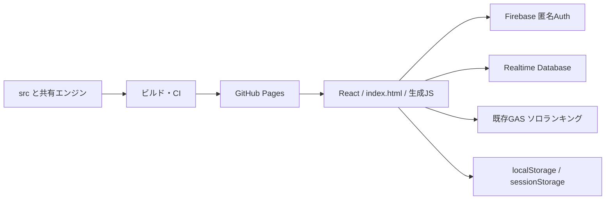

# システム構成

## 実行構成

GitHub Pagesの静的HTML/JSがブラウザ内でReactを実行し、Firebase Authentication（匿名UID）とRealtime Database（RTDB）、既存Google Apps Script（GAS）のソロランキングへ接続する。新オンラインも**Sparkのクライアント方式**であり、Cloud Functionsは必須ではない。

根拠：[index.html:10970・`function AppRoot`](https://github.com/asumax1128/factorfactor/blob/558488543e104460a35a8902c22e682c5c46f766/index.html#L10970)、[index.html:7519・`function fbStart`](https://github.com/asumax1128/factorfactor/blob/558488543e104460a35a8902c22e682c5c46f766/index.html#L7519)、[scripts/build-pages.cjs:7・`out =`](https://github.com/asumax1128/factorfactor/blob/558488543e104460a35a8902c22e682c5c46f766/scripts/build-pages.cjs#L7)。

## ファイルと編集責務

|場所|責務|編集上の注意|
|---|---|---|
|`index.html`|旧UI、ソロ、数学ジェネレータ、CPU、ルームA/旧B/C、大会、レイド、教師、プロフィール、報酬、ルート接続|巨大な単一ファイル。長い音声data URIを読み回さず関数を特定する。コメントの旧ver番号を正式版と混同しない|
|`src/online-rated-ui.jsx`|Sparkのメニュー、投票、戦闘、結果、ランキング|名前はratedだが本番接続は`OnlineSpark.create`|
|`src/online-spark-client.cjs`|本人移行、マッチング、同期、結果適用、ゴースト、復帰|公開生成物`online-spark.js`の元|
|`server/online-rated/core.cjs`|レート・季節・掲載順位・遷移の純粋処理|サーバーというフォルダ名だけで管理サーバー稼働と判断しない|
|`server/online-rated/engine.cjs` / `b2.cjs`|A/旧Bのアダプタと新時間制B|`rules==='b2'`で分岐。旧CPU/Cへ一括適用しない|
|`server/online-rated/engine-source.js`|indexから抽出した数学・旧B処理|生成物。直接直さず抽出元とビルドを確認|
|`src/daily-*` / `server/daily-play.cjs`|挑戦権・ランキング・日次称号・デイリー戦闘|新旧DailyAppを区別|
|`src/room-b2-*` / `src/b2-pump.cjs`|通常ルーム新Bと観戦応援|共有時刻のintent順序・本人枠を維持|
|`src/ghost-model.cjs` / `hyper-select.cjs`|学習統計から相手を構成、TOP10重み抽選|実プレイ録画の再生ではない|
|`src/a-result.cjs` / `online-state-order.cjs`|確定得点記録／古い画面状態の拒否|表示と公式得点を混同しない|
|`math-tower-core.js` / `math-tower-store.js`|現行先生試遊のルール・移行・revision保存|旧`TowerApp`とは別|
|`src/math-tower-ui.jsx` / `math-tower/chapter1.json`|先生試遊UIと第1章の原稿・画像・policy|現状は1〜5階。新しい章をJSON追加だけで完成としない|
|`online-rated.css` / `math-tower.css` / index内CSS|専用ルート／旧共通デザイン|数式フォントと他モードへ漏れる全体CSSを保護|
|ルートの`*-ui.js`,`online-spark.js`,`math-tower-release.js`,`game-version.js`|ブラウザ配信用生成物|対応するsrcやpolicy/versionを直し、承認後のビルドで再生成|
|`firebase/`|認可モジュール、断片、候補全体、Emulator設定|候補は現在のConsole全文そのものを取得した保証ではない|
|`scripts/`|ビルド、版番号検査、監査、ルール準備、ローカル試遊パッケージ|調査時に生成スクリプトを無断実行しない|
|`tests/`|ユニット、モックブラウザ、実SDK/Emulator|本番データにテストを向けない|
|`reports/` / `docs/`|監査台帳、測定記録、旧引継ぎ、設計・運用|古い文書の「未実装」を現行へ無条件転用しない|
|`suri-data.js`, `img/`, `fonts/`, `manifest.webmanifest`|旧塔の物語、動的画像、数式フォント、インストール表示|動的画像の静的未参照だけで削除しない|

## 依存の実態

- 開発側：Node 24、esbuild 0.23.1、Playwright 1.64.0、firebase 12.12.0、rules-unit-testing 5.0.1、React 18.3.1、Babel standalone 8.0.7、Tone 14.8.49。正確な固定解決値は`package-lock.json`。
- **配信HTMLのSDKはFirebase compat 10.12.2**。開発SDKと同一バージョンとは限らない。
- 配信Reactはunpkgの`react@18`/`react-dom@18`、Babelはunpkg、TailwindはCDN、Toneは14.8.49、KaTeX CSSは0.16.9。一部CDNは厳密版固定でない。
- `MathText`は文字列をspan/supへ分解する独自描画。KaTeXのCSS/フォントを利用するが、通常問題を`katex.render`で解析する実装と同一視しない。
- indexの`app-source`は起動時にBabel変換して実行。生成UIはesbuild。起動エラー用の別スクリプトがReact/Babel/Tone不足と未処理Promiseを案内する。

根拠：[package.json:39・`"devDependencies"`](https://github.com/asumax1128/factorfactor/blob/558488543e104460a35a8902c22e682c5c46f766/package.json#L39)、[index.html:22・`firebase-app-compat`](https://github.com/asumax1128/factorfactor/blob/558488543e104460a35a8902c22e682c5c46f766/index.html#L22)、[index.html:667・`function MathText`](https://github.com/asumax1128/factorfactor/blob/558488543e104460a35a8902c22e682c5c46f766/index.html#L667)、[index.html:11036・`var transformed = Babel.transform`](https://github.com/asumax1128/factorfactor/blob/558488543e104460a35a8902c22e682c5c46f766/index.html#L11036)。

## 起動と分岐

`AppRoot`のmodeはsolo/battle/daily/learn/raidw/tower。初期値はsolo、`#math-tower`はtowerへ遷移するが権限チェックは別途実施。アカウント未選択なら`AccountGate`。`BattleApp`がconfig確認後にSpark入口と旧ルーム／CPU等を分ける。`DBX`はCPUのローカルDBであり、EXP保存まで全てローカルになるわけではない。

`NewDailyApp`はready読取が成功した場合に使用、失敗時は旧`LegacyDailyApp`へ戻る。`MathTowerFactory`/生成JS不在時は安全な未読込表示。設定依存は[データ仕様](04_DATA_AND_FIREBASE.md)へ。

## 公開入口がない／別案のコード

`server/online-rated/service.cjs`、`functions.cjs`とv2専用ルール/移行計画は管理サービス案・開発用コード。現行indexのtransportはSparkであり、公開ページがそのFunctionsを必須利用するとは記載しない。`archive.cjs`も公開ブラウザの入口と対応するかを確認してから扱う。旧TowerApp/旧QMは互換性用コードとして配信ソースに残る。公開状況は[機能台帳](01_GAME_OVERVIEW.md)を参照。

関連：[UIと画像](08_UI_AND_ASSETS.md)、[ビルドとCI](09_TEST_AND_DEPLOY.md)。

[総合案内へ](00_START_HERE.md)
