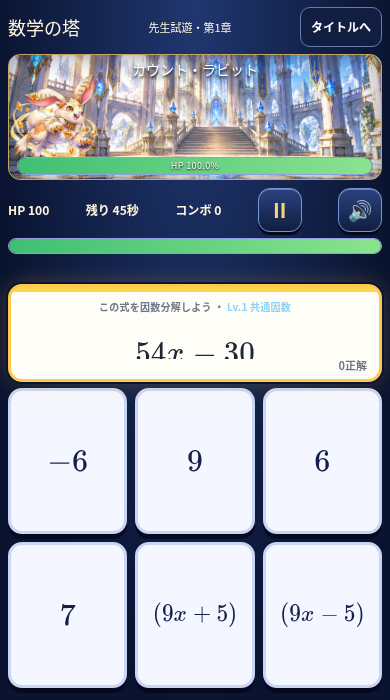
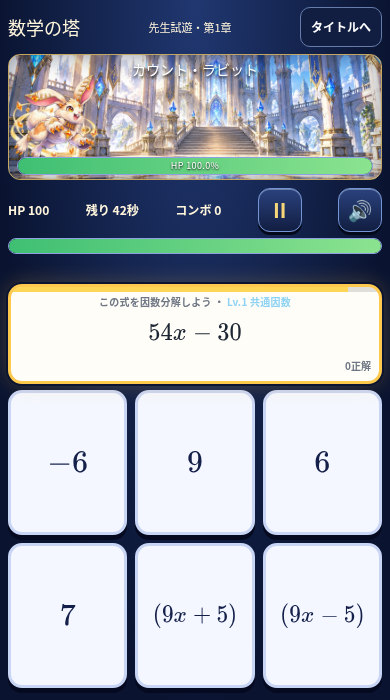
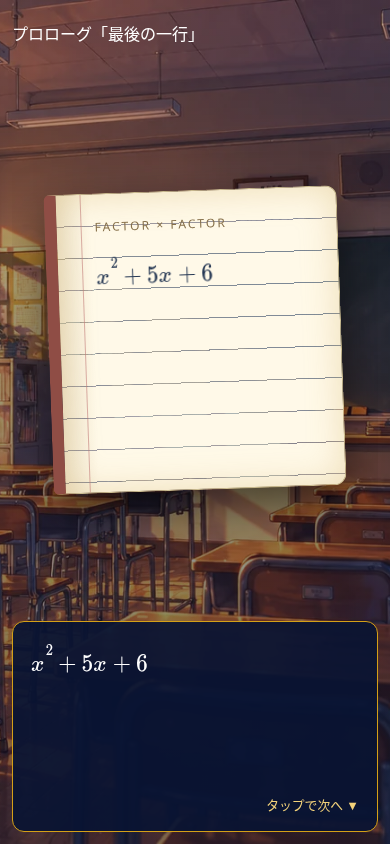
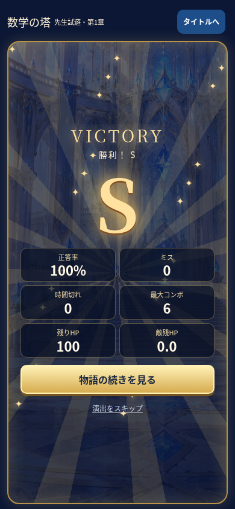

# 第1章：数式の切れ・図鑑・書体・勝利演出の修正

基準main：`c426284`。作業ブランチ：`fix/tower-formula-and-victory-ui`。

## 1. 数式の切れ：原因と修正

旧表示では固定高の問題枠の中をflexで縦に並べ、共有`.v7-poly`の大きいフォント／行高を残したまま、その子の`.fxm`へ別の文字サイズを指定していた。高さが足りないと数式の親が縮み、親の`overflow:hidden`が文字を切った。調整処理も横幅しか見ていなかった。

390×700と実際のKaTeXフォントで、報告と同じ`54x − 30`の下部切れをChromiumで再現した。親の高さ41px、行高57.75px、文字の下端が親を12px超えていた。Safari固有の不具合と決めつけず、まずこのCSSの構造を修正した。アドレスバー伸縮で利用可能高さが小さくなる場面でも目立つ構造だった。Safari実機固有の差は未検証。

塔専用のTarget部品で見出し・数式・正解数を独立した3段へ配置する。数式の親は縮まず、上下を中央揃えし、親と子の行高の不整合をなくした。文字の矩形と指数などのDOM Rangeを測り、縦横両方へ余白付きで収める。ResizeObserver、フォント読込完了、visualViewport変化に追従する。魔法弾の経由座標も数式領域そのものに合わせた。

| 390×700・同じ数式 | 修正前 | 修正後 |
| --- | --- | --- |
| 数式の親の高さ | 41px | 46px |
| 下部のはみ出し | 12px | 0px |
| カード1枚の高さ | 146px | 145px |

カードは3列×2行を維持し、この比較では高さの差は1px。代表Lv1〜Lv9と長い4次式を320×568、375×667、390×700、390×844、430×932、1366×768で検証した。縦横の文字境界が問題枠内に収まり、390px幅で高さを600→760→650→844へ変えても切れなかった。フォント読込失敗時の代替書体でも確認した。

| 修正前 | 修正後 |
| --- | --- |
|  |  |

詳細な数値は[比較JSON](images/ui4/formula-comparison.json)。スクリーンショットはローカルの模擬先生と公開済み第1章素材によるもの。実ユーザーの記録ではない。

## 2. モンスター図鑑

「画像を見る」へ改名し、画像アイコン付きの小さいボタンへ変更。タッチ領域は44pxを確保する。遭遇フラグと名前の解放フラグを確認し、実際に画像が読み込めた場合だけ表示する。未遭遇・未解放・画像未設定・デコード失敗の画像ボタンは出さない。階・説明・討伐回数は維持する。

画像元は`content.characters[content.floors[floor]].image`を維持し、実際のデータURIがデコードできることを検証した。モーダルをダイアログとして扱い、「✕ 画像を閉じる」を明示。ズーム・ドラッグも保持し、表示後の読込エラーにも対応する。

## 3. ノートと会話の数式書体

既存のMathTextレンダラーを両方で使用し、xのイタリック、数字・演算記号の直立、指数の組版を統一する。通常の会話文とは区別する。ノートの文章・背景・紙面を差し替えず、数式行の余白と行高だけを調整した。

既存と同じKaTeX 0.16.9の公式配布物からMain Regular／Math Italicをそのまま同梱し、塔のクラスにだけ適用する。コード・字体を改変していない。パッケージとフォント源のMITライセンスを保持し、公開成果物にも含める。[出典・ハッシュ・ライセンス](../fonts/katex/README.md)。共有のソロ等の数式表示は変更しない。古いHTMLとの一時的な混在でも、渡されていないレンダラーを参照して落ちないための互換表示を用意した。

## 4. 共通勝利演出

VICTORY、金色の大きな評価、短い光、粒子、成績6項目の順次表示を実装。Sは24粒子と光条、Aは16粒子と青い光、B/Cは8粒子と落ち着いた配色にする。評価基準は変更しない。次への金色ボタンは常時操作可能で、演出スキップもある。動きを減らす設定ではアニメーションを停止する。

Victory部品をFactoryから返し、後続章でも再利用できる。確定したoutcomeを受け取る表示専用部品で、Firebase保存や進行処理を呼び出さない。保存成功後のresult画面でだけ表示し、失敗時に勝利扱いしない。新しい音声を発生させず、共有ミュートを維持する。画面の小さい場合も成績と次へを操作できる。

## テストと影響範囲

- `test:tower:polish`をActionsへ追加。旧版の12px切れを再現してから、Lv1〜Lv9・長い式・6サイズ・高さ変更・フォント失敗、数学書体、図鑑の正しい画像と未解放／欠損／不正画像、S/A/B/C演出、小型画面の次へ、音量OFF、スキップと保存1回を検証。
- 塔ユニット22件、従来の塔ブラウザ23項目、RPGの配置／移行／攻撃／カットイン、保存復旧5項目、音声ユニット3件とブラウザ3項目を再実行。
- 共有関数226個のAST比較、既存ゲーム5項目、オンライン・大会・クラスレイド3項目、アカウント・ランキング2項目。ソロや他モードの表示・音声・成績保存は変更しない。
- 実SDK＋Realtime Databaseエミュレータの認可17項目×2、既存ルール回帰157件、連続保存・真の競合・事前取得後の競合・旧データ移行／バックアップを検証。
- Pagesの限定成果物・生成UI一致・actionlint・差分検査。

本番Firebaseへの管理者操作、ルール・grant・記録の変更は行わない。保存エンジン、難易度別冒険、判定・暫定数値、ストーリー・敵・画像データは変更していない。比較画像はPagesの配布物へ追加しない。公開は既存Actionsの全検証成功後のみ。

未検証：iPhone Safari実機の描画とタッチ、実際のアドレスバー伸縮・セーフエリア、iOSでのフォント代替。Chromiumの画面サイズ・高さ変化と実機検証は区別する。公開後は更新済みURLで同じ式・長い式、カードのドラッグ、攻撃の経由位置、ノートの書体、図鑑の閉じる操作、勝利画面の次へを実機確認する。
